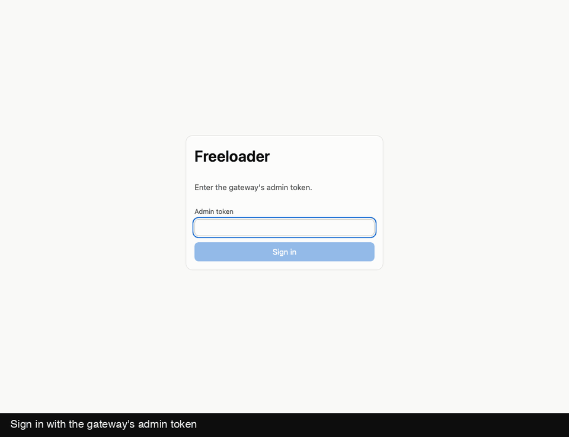
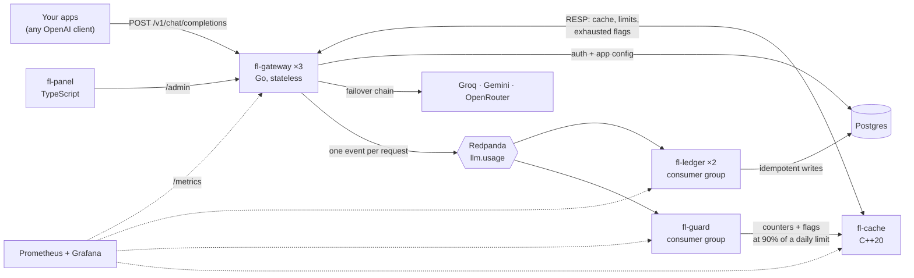
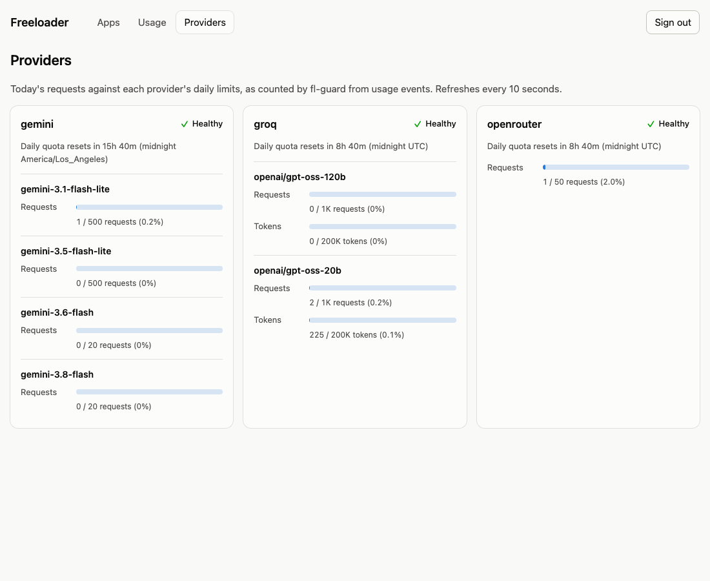
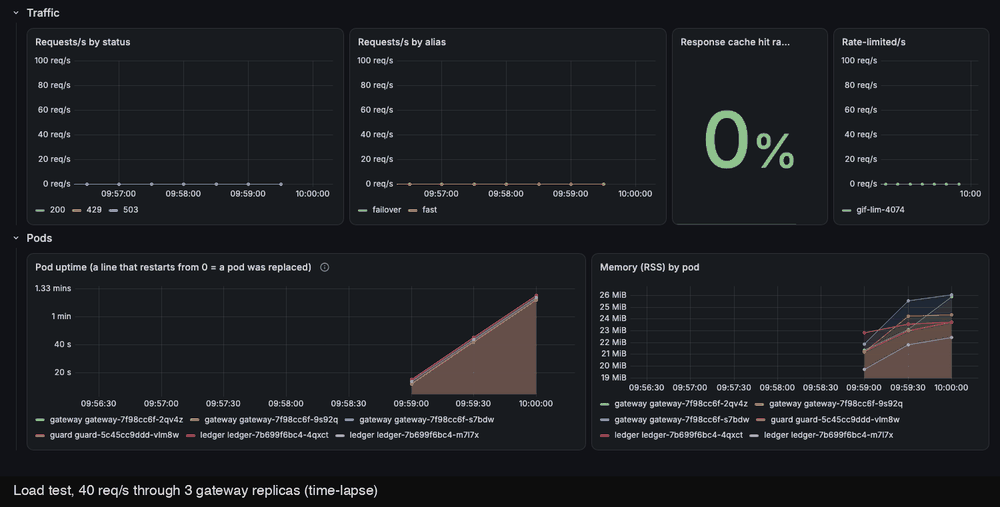
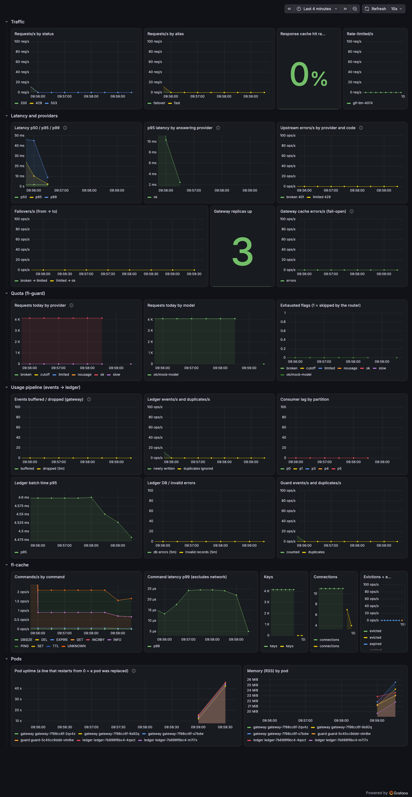

# Freeloader

[](https://github.com/aarshitaacharya/freeloader/actions/workflows/ci.yml)

A self-hosted, OpenAI-compatible gateway in front of free LLM providers (Groq, Google AI Studio, OpenRouter).
Point any OpenAI client at it and your free quotas go further:

1. **Cache.** An identical request seen before is answered from a cache in milliseconds and uses no quota.
2. **Per-app limits.** Every app has its own key, requests-per-minute and tokens-per-day budget, so one runaway script can't drain the shared quota.
3. **Failover.** A provider that returns 429, 5xx or times out is skipped and the request moves to the next one. A provider that is near its daily limit is skipped before it fails.
4. **Usage record.** Every request becomes an event that feeds a Postgres ledger, a quota guard and the dashboards.



<sup>Real run against the local Kubernetes stack with the offline mock provider (so it spends no free quota). The terminal frame is real `curl` output.</sup>

The cache server is written from scratch in C++ (RESP-compatible, so `redis-cli` talks to it) and benchmarked against Redis. Everything around it is Go, plus a TypeScript control panel, Kubernetes manifests and a Grafana dashboard. It is a learning project built level by level, with tests and CI at every level.

## Architecture



| Component | Language | What it is |
|---|---|---|
| [`cache/`](cache) | C++20 | In-memory server speaking a RESP2 subset. Acceptor thread + N epoll workers, 64 sharded maps, TTLs, approximate-LRU eviction, graceful drain, `/metrics`. Linux-only (epoll). |
| [`gateway/`](gateway) | Go | The front door. Auth by key hash, rate limits, response cache, alias routing with failover and cooldowns, SSE streaming, `/admin` API. |
| [`ledger/`](ledger) | Go | Consumes usage events into Postgres. A redelivered event is a no-op; offsets commit only after the database commit; the whole history can be replayed from the log. |
| [`guard/`](guard) | Go | Independent consumer group. Counts usage per provider and per model, and sets an "exhausted" flag in fl-cache at 90% of a daily limit, expiring at that provider's own midnight. |
| [`panel/`](panel) | TypeScript | Vite + React in strict mode: Apps, Usage and Providers pages. Types are generated from the OpenAPI spec and every response is validated at runtime. |
| [`deploy/`](deploy) | YAML | Docker Compose for daily use; Kustomize + Helm for a local [kind](https://kind.sigs.k8s.io) cluster with ingress, probes, a PodDisruptionBudget and Prometheus/Grafana. |

## Run it

You need Docker. The offline mock provider means you can try everything without an API key.

```bash
make up-mock                      # Postgres, Redpanda, fl-cache, gateway, ledger ×2, guard, panel, mock provider
make app NAME=demo                # prints an API key once

curl localhost:8080/v1/chat/completions \
  -H "Authorization: Bearer fl_..." -H "Content-Type: application/json" \
  -d '{"model":"fast","messages":[{"role":"user","content":"Say hi"}]}'
```

The control panel is at <http://127.0.0.1:3001>; sign in with `ADMIN_TOKEN` from `.env` (`make init` generates one). If port 8080 is taken on your machine, set `GATEWAY_PORT` in `.env`.

**With real providers:** `make init`, put your keys in `.env` (it is gitignored), check `config/providers.yaml`, then `make up`. Provider model IDs and limits change often; the example config says where each number came from, and anything not verified is marked as such.

**Any OpenAI client works:**

```python
from openai import OpenAI
client = OpenAI(base_url="http://localhost:8080/v1", api_key="fl_...")
stream = client.chat.completions.create(model="fast", stream=True,
                                        messages=[{"role": "user", "content": "Say hi"}])
```

`model` is an alias (`fast`, `smart`, `vision` in the example config) that expands to an ordered list of providers, or `provider/model-id` to pin one. Response headers show what happened: `X-Freeloader-Provider`, `X-Freeloader-Cache` (`HIT`/`MISS`/`BYPASS`) and `X-Freeloader-Attempts`.

### On Kubernetes (kind)

```bash
make kind-up-mock       # builds the images, creates the cluster, deploys everything (about 3.5 minutes from nothing)
make kind-monitoring    # Prometheus + Grafana with the dashboard provisioned
make kind-grafana       # prints the Grafana password; Grafana :3000, Prometheus :9090
make kind-drill         # deletes a gateway pod in the middle of a 60 s load test
```

The panel and API are at <http://127.0.0.1:8090/> (admin token: `kubectl --context kind-freeloader -n freeloader get secret freeloader-secrets -o jsonpath='{.data.ADMIN_TOKEN}' | base64 -d`). `make kind-up` uses your real provider keys from `.env` instead of the mock; `kind` and `helm` are downloaded into a gitignored `.bin/`.

## What I measured

Every number below came from a command in this repo. None are quoted from elsewhere.

**fl-cache vs Redis 7.0.15** (`make bench`, then `make bench-report`; full tables and environment in [`bench/results.md`](bench/results.md)). Medians of 5 runs, all servers pinned to the same 4 vCPUs:

| | fl-cache (4 threads) | Redis, default | Redis, 4 I/O threads |
|---|---:|---:|---:|
| SET, 128 clients, req/s | 181k | 43k | 90k |
| SET p99, 128 clients | 1.57 ms | 5.11 ms | 2.84 ms |

In an in-process microbenchmark, 64 shards gave **7.4× the single-lock throughput at 16 threads** (0.61M → 4.49M ops/s). More in [`bench/findings.md`](bench/findings.md).


**Cache HIT latency through the gateway** (`make check-hit-latency`, inside the Docker network): p50 2.6–5.8 ms and p99 about 6–10 ms across runs. The gateway's own handler time was about 1.4 ms; the rest is the Docker bridge and the client.

### Failure drills

Each one was run, not just reasoned about. They double as the demo.

| Drill | What happened | How to repeat |
|---|---|---|
| **Delete a gateway pod** during a 60 s load test at 50 req/s | 3000 of 3000 requests succeeded on every run (four runs, one of them with the preStop sleep removed; see ADR 0009). A 100 s run at 40 req/s with the Grafana capture below: 3999 of 3999. | `make kind-up-mock`, `make kind-drill` |
| **Hard-kill both ledger replicas** mid-batch, then restart | `usage_events` = exactly the 100 requests sent; rollup exactly 100 requests / 1500 tokens; the dedupe fired 35 times on one replica. | integration tests in `ledger/` (`make gateway-integration`) |
| **Replay** the whole log into empty tables | Refused while a ledger is running. With the ledgers stopped, both tables rebuilt with byte-identical fingerprints. | `make ledger-replay` |
| **Lower a provider's daily limit** below its count | The guard flagged it at startup; the next request got an immediate 503 with no upstream call; raising the limit cleared the flag. | edit `config/providers.mock.yaml`, restart the guard |
| **Break a provider's key** | Groq 401 → Gemini 402 → OpenRouter answered on attempt 3, and the next request skipped both dead providers. | revoke a key in `.env` |
| **Take the event broker down** | Serving was unaffected; the gateway's "buffered" gauge rose, then events were dropped after about 13 s and delivery resumed on recovery. | `docker compose stop redpanda` |

And the gateway keeps serving, without caching or limits, when fl-cache is unreachable (ADR 0003, covered by `TestServesNormallyWhenCacheIsDown` and `TestRecoversWhenCacheComesBack`).

### Real providers on the cluster

`make kind-up` with real keys, then a few requests through the ingress (one sample each, from my laptop, so read them as "it works", not as benchmarks):

| Request | Result |
|---|---|
| `fast` (Groq first) | 200 in 0.44 s, `X-Freeloader-Cache: MISS` |
| the same request again | 200 in 8.9 ms, `HIT` |
| `gemini/gemini-3.1-flash-lite` | 200 in 8.2 s |
| `openrouter/minimax/minimax-m3.1-flash:free` | 200 in 0.93 s |
| `fast` with `stream: true` | first byte after 0.27 s, 37 chunks |

The ledger then showed Groq 3 requests (one a cache hit), Gemini 1 and OpenRouter 1, and fl-guard counted Groq as 2: a cache hit uses no quota. The panel shows the same numbers against each provider's limits:



### Observability

A Grafana dashboard is generated from code ([`tools/dashboard/gen.py`](tools/dashboard/gen.py)) and provisioned into the cluster: traffic, latency by provider, failovers, quota burn, the event pipeline, fl-cache, and pod uptime. Six alert rules are loaded into Prometheus. The GIF is a time-lapse of a real run: a gateway pod is deleted mid-test and a new pod appears in the uptime panel while the load test finishes with zero failures.



<details>
<summary>The whole dashboard</summary>



</details>

## How it is tested

- **fl-cache:** 55 GoogleTest tests (parser edge cases, concurrency, expiry, eviction, shutdown), run in CI under plain, AddressSanitizer and ThreadSanitizer builds.
- **Go services:** 133 test functions (gateway 98, guard 21, ledger 14), table-driven with `-race`, and integration tests (build tag `integration`) against real Postgres, real Redpanda and the real fl-cache binary in containers via testcontainers. `golangci-lint` is clean on every module.
- **Admin API contract:** a test sends real requests to the handler and validates each response, errors included, against [`api/openapi.yaml`](api/openapi.yaml).
- **Panel:** 60 tests (Vitest and Testing Library), `tsc --noEmit` in strict mode with no `any` (also enforced by ESLint), and a CI check that the generated API types match the spec.
- **Kubernetes manifests** are rendered and schema-validated in CI.
- Many components were also mutation-tested by hand: break the logic on purpose and confirm a test fails.

CI runs all of it on every push (`.github/workflows/ci.yml`).

## Design decisions

One short ADR per big choice, in [`docs/decisions/`](docs/decisions):

| # | Decision |
|---|---|
| [0001](docs/decisions/0001-use-resp.md) | Speak RESP so existing clients and `redis-benchmark` work against fl-cache |
| [0002](docs/decisions/0002-fixed-window-rate-limits.md) | Fixed-window rate limits, and what that costs at window edges |
| [0003](docs/decisions/0003-cache-state-is-disposable.md) | Cache state is disposable; the gateway fails open |
| [0004](docs/decisions/0004-response-cache-key-and-opt-in.md) | What goes in the cache key, and why non-deterministic requests are opt-in |
| [0005](docs/decisions/0005-provider-cooldowns.md) | Which errors put a provider in cooldown |
| [0006](docs/decisions/0006-usage-events-are-best-effort.md) | Usage events are best-effort, with a non-idempotent producer on purpose |
| [0007](docs/decisions/0007-ledger-exactly-once-in-effect.md) | Exactly-once *in effect* from at-least-once delivery |
| [0008](docs/decisions/0008-guard-quota-scopes.md) | Quota flags per provider and per model, in the provider's own timezone |
| [0009](docs/decisions/0009-kubernetes-layout.md) | Kubernetes layout, and what the preStop sleep does and doesn't buy |
| [0010](docs/decisions/0010-observability-stack.md) | kube-prometheus-stack, a generated dashboard, rules without Alertmanager |
| [0011](docs/decisions/0011-admin-api-and-panel.md) | Admin API in the gateway, OpenAPI as the contract |

[`docs/ownership.md`](docs/ownership.md) is a table of who owns every resource in the C++ server and when it dies.

## Repository tour

```
cache/        C++ server: src/, include/, tests/, CMake presets, Dockerfile
gateway/      Go: cmd/{gateway,mkapp,loadgen}, internal/{auth,ratelimit,cache,route,provider,events,admin,server,...}
ledger/       Go: consumer + replay
guard/        Go: quota guard
panel/        TypeScript control panel (Vite + React), nginx image
api/          openapi.yaml (admin API) and the shared usage-event contract
migrations/   SQL (golang-migrate)
config/       providers.example.yaml (no secrets); providers.mock.yaml for offline runs
deploy/       compose/  k8s/{base,overlays,monitoring}  kind/
bench/        benchmark scripts, raw CSVs, results.md and findings.md
tools/        mock-provider, dashboard generator, README media scripts, client checks
docs/         decisions/ (ADRs), ownership.md, img/
```

Handy targets (the full list is in the [`Makefile`](Makefile)):

| Target | Does |
|---|---|
| `cache-test`, `cache-asan`, `cache-tsan` | Build and test the C++ server in Docker (it is Linux-only) |
| `gateway-test`, `gateway-integration` | Go unit tests; Go integration tests with real containers |
| `up`, `up-mock`, `down`, `app NAME=` | The Compose stack and app creation |
| `panel-check`, `panel-dev` | Everything CI checks for the panel; dev server with a proxy |
| `kind-up[-mock]`, `kind-down`, `kind-drill`, `kind-monitoring`, `kind-grafana` | The Kubernetes stack and its drills |
| `bench`, `bench-store`, `bench-report` | Benchmarks against Redis |

The GIFs above were recorded with [`tools/readme-media/`](tools/readme-media) (Playwright for the browser steps, Pillow to assemble them); the README there explains how to regenerate them.
