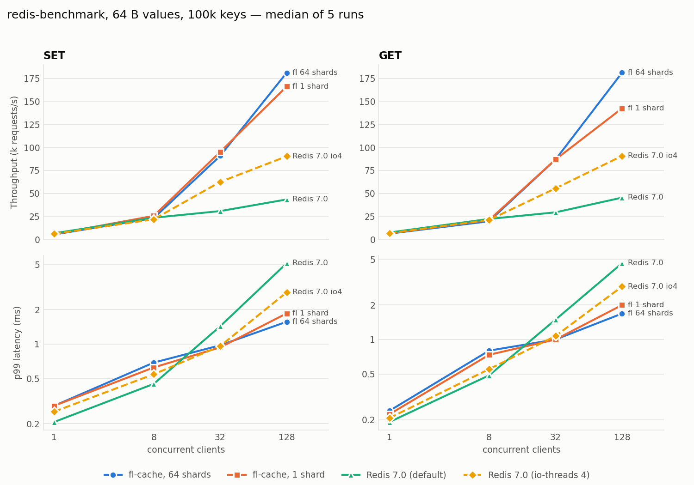
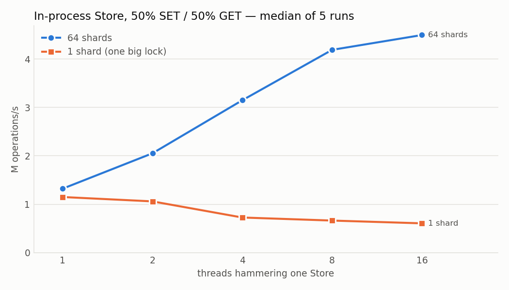

# fl-cache benchmark results

Every number below is generated by `bench/report.py` from the raw CSVs in `bench/raw/`.
Nothing here is typed in by hand except the *Findings* section.

## Findings

Medians over 5 runs; ranges are in the tables below. The VM is noisy (run-to-run spread is large), so
I only call a difference real when the min–max ranges do not overlap.

1. **Sharding removes real lock contention — in the store.** With one big lock, adding threads makes the
   store *slower*: 1.15M ops/s at 1 thread falling to 0.61M at 16. With 64 shards it scales from 1.32M to
   4.49M ops/s, **7.4× the single-lock throughput at 16 threads**. From 2 threads up, the two
   configurations' ranges do not overlap.
2. **Over the network, 1 shard vs 64 shards is not distinguishable with these runs.** At 1, 8 and 32 clients
   they are within noise. At 128 clients the medians favour 64 shards (SET 181k vs 166k req/s; GET 181k vs
   142k; p99 1.57 vs 1.85 ms SET, 1.68 vs 1.99 ms GET), but the ranges overlap, so I would not claim it.
   Likely reason (an inference, not tested): peak network load here is ≈0.18M ops/s, well under the
   ≈0.6–1M ops/s where a single lock saturates in the microbenchmark, so the lock is not the bottleneck
   yet. A faster machine, more worker threads, or pipelined load would be needed to see it end to end.
3. **At high concurrency fl-cache out-scales Redis in this setup.** At 128 clients (SET): fl-cache 181k req/s
   vs 43k for default single-threaded Redis (≈4.2×) and 90k for Redis with 4 I/O threads (≈2×); p99 1.57 ms
   vs 5.11 ms and 2.84 ms. At 32 clients: ≈3× default Redis. This is **not** a per-core or per-feature
   comparison: fl-cache ran 4 worker threads, default Redis one main thread, and Redis does far more.
4. **At low concurrency Redis is slightly ahead on latency.** At 1 and 8 clients throughput is the same within
   noise (client round-trip bound), but Redis's p99 is lower (SET, 1 client: 0.21 vs 0.29 ms; 8 clients:
   0.45 vs 0.69 ms). I have not investigated why (candidates: epoll wake-up and handoff costs, per-command
   timing for the histogram).

**What this does and doesn't support for a resume bullet.** Supported: "sharded locks raised in-process store
throughput 7.4× at 16 threads (0.61M → 4.49M ops/s)", and "reached 181k req/s at 128 clients vs 43k for
single-threaded Redis 7.0 on the same pinned CPUs". Not supported: a network-level "sharding cut p99 from X to
Y ms" (finding 2), or "within N% of Redis throughput" (fl-cache exceeded it at ≥32 clients, in a Docker Desktop VM).

## Environment

```
date: 2026-10-19T23:57:42Z
kernel: Linux 6.12.76-linuxkit x86_64
vcpus: 16
cpu: Intel(R) Core(TM) i9-9880H CPU @ 2.30GHz
mem_mb: 7935
compiler: g++ (Ubuntu 13.3.0-6ubuntu2~24.04.1) 13.3.0
redis: Redis server v=7.0.15 sha=00000000:0 malloc=jemalloc-5.3.0 bits=64 build=d064f9f48c901a92
fl-cache git: b4f8f37
params: reps=5 clients=[1 8 32 128] keyspace=100000 payload=64B server_cpus=0-3 client_cpus=8-15
fl-cache: --threads 4 --metrics-port 0 (CMake Release build type)
redis: --save '' --appendonly no (redis-io4 adds --io-threads 4 --io-threads-do-reads yes)
```

fl-cache runs with `--threads 4`; Redis runs single-threaded unless noted. All servers are pinned
to the same 4 vCPUs; the load generator is pinned to a disjoint set. Both run in one Linux container
inside Docker Desktop's VM, over loopback — see *Caveats*.

## 1. Network benchmark: fl-cache vs Redis



Reproduce: `make bench` (≈25 min), then `make bench-report`.
Each run is `redis-benchmark -p PORT -c <clients> -n <requests> -d 64 -r 100000 -t <set|get> --threads <min(clients,8)> --csv`;
keys are preloaded (`bench/preload.py`) so every GET hits. Each server is restarted and preloaded
for every repetition, and the four configurations are interleaved within each repetition so slow
drift (thermal, noisy neighbours) is spread across them rather than favouring one.
Request counts: 50k (1 client), 300k (8 clients), 500k (32 and 128 clients).

**SET throughput, requests/s** — median (min–max) over 5 runs

| clients | fl-cache, 64 shards | fl-cache, 1 shard | Redis 7.0 (default) | Redis 7.0 (io-threads 4) |
|---:|---:|---:|---:|---:|
| 1 | 5.3k (4.7k–9.0k) | 5.6k (2.7k–6.1k) | 6.6k (5.8k–7.7k) | 6.0k (5.3k–6.2k) |
| 8 | 23.1k (22.6k–32.4k) | 25.5k (16.4k–27.9k) | 23.5k (20.0k–24.5k) | 21.8k (19.3k–23.1k) |
| 32 | 90.7k (86.8k–110.8k) | 95.0k (76.8k–95.1k) | 30.7k (27.4k–35.6k) | 62.4k (52.6k–64.4k) |
| 128 | 181.1k (153.1k–221.7k) | 166.1k (152.8k–181.2k) | 43.4k (37.6k–53.9k) | 90.2k (79.9k–94.7k) |

**SET p99 latency, ms** — median (min–max) over 5 runs

| clients | fl-cache, 64 shards | fl-cache, 1 shard | Redis 7.0 (default) | Redis 7.0 (io-threads 4) |
|---:|---:|---:|---:|---:|
| 1 | 0.29 (0.22–0.35) | 0.29 (0.25–1.09) | 0.21 (0.18–0.25) | 0.26 (0.24–0.28) |
| 8 | 0.69 (0.49–0.71) | 0.62 (0.57–0.95) | 0.45 (0.43–0.54) | 0.54 (0.49–0.58) |
| 32 | 0.97 (0.77–1.05) | 0.94 (0.87–1.18) | 1.43 (1.33–1.65) | 0.96 (0.94–1.53) |
| 128 | 1.57 (1.22–1.89) | 1.85 (1.62–1.94) | 5.11 (3.86–6.01) | 2.84 (2.70–3.12) |

**GET throughput, requests/s** — median (min–max) over 5 runs

| clients | fl-cache, 64 shards | fl-cache, 1 shard | Redis 7.0 (default) | Redis 7.0 (io-threads 4) |
|---:|---:|---:|---:|---:|
| 1 | 6.2k (5.6k–8.8k) | 6.6k (3.1k–7.2k) | 7.4k (6.4k–8.0k) | 6.7k (5.9k–7.1k) |
| 8 | 19.6k (19.0k–27.9k) | 21.0k (17.6k–24.0k) | 22.2k (19.0k–24.0k) | 21.1k (19.3k–22.2k) |
| 32 | 86.7k (83.0k–105.0k) | 86.8k (79.7k–90.7k) | 29.4k (26.9k–35.7k) | 55.5k (49.8k–58.7k) |
| 128 | 181.2k (153.4k–221.3k) | 142.4k (142.2k–181.2k) | 45.3k (43.4k–51.2k) | 90.7k (83.0k–95.0k) |

**GET p99 latency, ms** — median (min–max) over 5 runs

| clients | fl-cache, 64 shards | fl-cache, 1 shard | Redis 7.0 (default) | Redis 7.0 (io-threads 4) |
|---:|---:|---:|---:|---:|
| 1 | 0.24 (0.21–0.27) | 0.22 (0.20–0.70) | 0.19 (0.17–0.23) | 0.21 (0.21–0.25) |
| 8 | 0.80 (0.57–0.86) | 0.73 (0.66–0.90) | 0.49 (0.46–0.59) | 0.55 (0.49–0.69) |
| 32 | 1.00 (0.82–1.09) | 1.00 (0.96–1.09) | 1.49 (1.19–1.98) | 1.07 (1.01–1.25) |
| 128 | 1.68 (1.21–1.85) | 1.99 (1.63–2.02) | 4.61 (4.11–5.31) | 2.89 (2.78–3.22) |


## 2. In-process Store microbenchmark

Same `Store` class the server uses, driven directly by N threads (no sockets, no parsing),
100k preloaded keys, 64 B values, 50% SET / 50% GET, 5 runs of 3 s per cell.
This isolates lock contention, which the network benchmark can hide behind syscall cost.



Reproduce: `make bench-store`, then `make bench-report`. Binary: `cache/build/release/fl-store-bench`.

| threads | 1 shard | 64 shards | 64 ÷ 1 |
|---:|---:|---:|---:|
| 1 | 1.15M (0.99M–1.72M) | 1.32M (0.93M–1.60M) | 1.15× |
| 2 | 1.06M (0.84M–1.32M) | 2.05M (1.95M–3.12M) | 1.94× |
| 4 | 0.73M (0.66M–1.07M) | 3.15M (2.64M–4.84M) | 4.33× |
| 8 | 0.66M (0.54M–0.89M) | 4.19M (3.88M–5.81M) | 6.31× |
| 16 | 0.61M (0.55M–0.63M) | 4.49M (4.14M–5.10M) | 7.41× |

## Caveats

- **Docker Desktop on a Mac.** The kernel is a LinuxKit VM; loopback round trips are far slower than
  on bare-metal Linux. Absolute numbers are not representative of production hardware. The comparison
  between configurations (same machine, same conditions, interleaved) is the meaningful part.
- **Hyper-threads.** The 16 vCPUs are the host's logical CPUs; I could not verify which vCPUs share a
  physical core, so "disjoint CPUs" for server and load generator does not guarantee disjoint cores.
- **One machine, one workload.** 64-byte values, uniform random keys, 100% hit rate, no pipelining.
  Skewed keys (a hot key) would behave differently, especially for the sharded store.
- **fl-cache times every command** (two `steady_clock` reads) for its latency histogram. Redis does
  no equivalent work on this path, so this slightly disadvantages fl-cache. The overhead was not
  measured separately.
- **p99 comes from `redis-benchmark`'s client-side histogram**, so it includes the load generator's own
  scheduling delays, and has millisecond resolution to 3 decimals.
